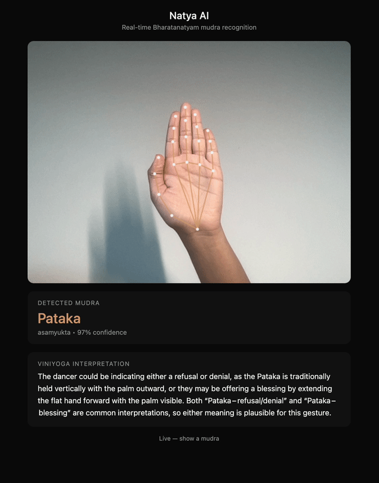
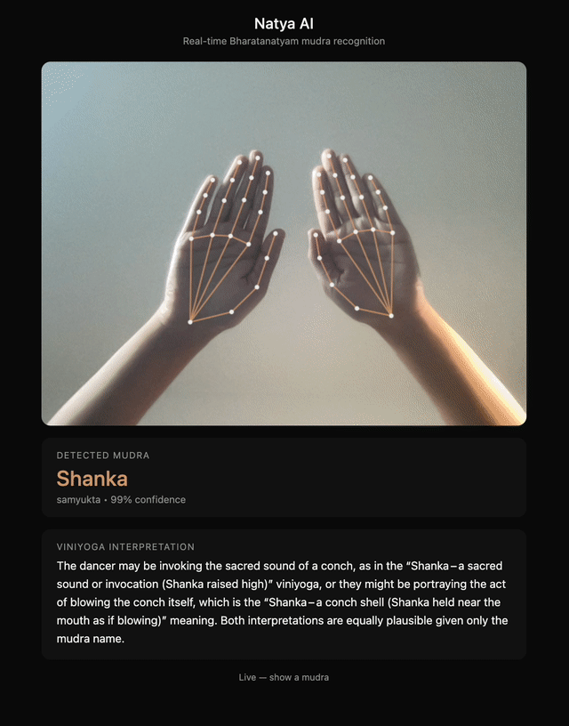

# Natya AI

| One-hand mudras | Two-hand mudras |
|---|---|
|  |  |

Real-time Bharatanatyam mudra recognition in the browser, with an LLM that explains each mudra's traditional meaning (viniyoga) using only entries from an expert-verified knowledge base.

**Live demo:** [natya-ai-fawn.vercel.app](https://natya-ai-fawn.vercel.app). The API runs on Render's free tier, so the first explanation after a period of inactivity can take 30–60 seconds while the server starts.

## Why this project

In Bharatanatyam, a mudra (hand gesture) is a symbol as well as a shape. Each mudra has viniyogas, which are traditional meanings documented in texts such as the *Abhinaya Darpana*. The same mudra can carry different meanings depending on where it is held. Pataka raised above the head can represent a cloud, while Pataka held at the chest carries a different meaning.

Identifying the mudra is a classification problem. Explaining its meaning in context, without introducing meanings that are not canonical, is the more difficult problem, and it is the point at which a generic gesture classifier is no longer sufficient for a dancer or student. Natya AI addresses both. It classifies mudras in real time on the user's device and then streams an explanation grounded in a knowledge base that I verified against 14+ years of Bharatanatyam training.

## Results

| | Result |
|---|---|
| One-hand (asamyukta) mudras, 28 classes | 94.52% top-1, 98.32% top-3, macro-F1 0.944 (2,208 held-out samples) |
| Two-hand (samyukta) mudras, 16 classes | 99.69% top-1, 100% top-3, macro-F1 0.997 (651 held-out samples) |
| Accuracy on randomly rotated hands | 21% → 94% after rotation augmentation |
| LLM answers grounded in a canonical viniyoga | 95% with RAG vs. 45% without |
| LLM answers with a non-canonical meaning | 0% with RAG vs. 10% without |
| Classifier inference (one-hand model) | 0.17 ms median |

The validation data comes from the same studio-style dataset as the training data, so these numbers do not measure live webcam accuracy. See [Limitations](#limitations).

## How it works

```
Webcam
  │
  ▼
MediaPipe Hands + Pose (JS, on-device, WASM)
  │  21 keypoints per hand, 33 pose landmarks
  ▼
Landmark normalization (wrist-centered, scale-normalized)
  │
  ▼
ONNX classifier (in-browser, onnxruntime-web)
  │  1 hand  -> asamyukta model (28 classes, attention)
  │  2 hands -> samyukta model  (16 classes, attention)
  ▼
Temporal smoothing (10-frame softmax average)
  │
  ▼
Stability gate (same top-1 label, >1s, >60% confidence)
  │
  ▼                                    Pose-derived context
  │                                    (arm raised / near chest /
  │                                    near face / extended forward)
  ▼                                              │
POST /interpret/stream  ◄───────────────────────┘
  │  (FastAPI + SSE)
  ▼
ChromaDB retrieval (top-6 viniyogas by embedding similarity,
  filtered to the detected mudra)
  │
  ▼
LLM (openai/gpt-oss-120b via Groq), restricted to the retrieved viniyogas
  │
  ▼
Streamed explanation → browser
```

Every stage before the `POST` runs on the user's device, so classification requires no server round trip.

## Issues and fixes

### Train/serve skew in landmark extraction

Live webcam testing repeatedly confused mudras that are visually distinct, such as Tripataka and Mayura, while validation accuracy remained above 97%. The cause was a mismatch between training and serving. The dataset landmarks had been extracted with MediaPipe's legacy Python API, whereas the browser uses the newer Tasks API, which runs a different landmark model.

To confirm the cause, I ran the same classifier on 222 dataset images using landmarks from each API. Legacy landmarks, which match the training data, scored 100%. Tasks landmarks, which match what the browser sends, scored 88.3%. Every error was an image that the legacy landmarks classified correctly and the Tasks landmarks did not.

The extraction script now uses the Tasks API with the same model files that the browser loads. Landmarks were re-extracted for all 28,431 images, and both classifiers were retrained.

The first evaluation of the retrained model also scored 100%, which was inconsistent with the overall validation accuracy. On inspection, 81% of those 222 images were in the training set, so the test largely measured memorization. Repeating the evaluation on 909 held-out images from the same affected classes gave 96.4%, with residual confusion involving Katakamukha_1 and Tripataka.

One-hand validation accuracy decreased after this fix (97.70% → 96.20%). This decrease is expected. The earlier figure was measured on the same type of landmarks used in training, which is the condition that concealed the defect. The new figure reflects the landmarks that the browser sends.

### Orientation used as a shortcut feature

After that fix, two mudras were still misclassified live. Chandrakala was classified as Suchi, and Bramaram as Katakamukha_1, despite 97–99% validation recall. The dataset photographs hands almost entirely side-on, at a fixed tilt for each class. In 80% of Chandrakala samples, the axis from the wrist to the middle knuckle lies 48–79° from vertical. The normalization step removed position and scale but not rotation, so the classifier learned tilt as a feature.

Rotating validation hands to an upright orientation reproduced the problem offline, with 0% accuracy on upright Chandrakala and 21% overall under random rotation. Adding random in-plane rotation during training (`random_rotate` in `src/data/preprocess.py`) raised these figures to 98% and 94%, at a cost of about 1.7 points of standard validation accuracy (96.20% → 94.52%).

An additional ±35° out-of-plane tilt was tested to simulate palm-facing views. It caused live Pataka to be classified as Sarpasirsha. The two mudras differ mainly by a slight cup and a backward angle of the hand, and the tilt augmentation produced that cue artificially. Removing the tilt reduced held-out Pataka→Sarpasirsha errors from 5% to 1%. Pataka is still occasionally classified as Sarpasirsha live, so this issue is not fully resolved.

### Prediction instability interrupting explanations

Per-frame predictions fluctuate as a hand moves between shapes. Averaging the softmax output over 10 frames stabilized the decision but not the displayed label. The pose context sent to the LLM ("near chest" vs. "near face") also fluctuated while the hand was stationary. Each change altered the request, so the app repeatedly canceled and restarted the LLM call before any text appeared. The fix combines an EMA filter on raw landmark positions with hysteresis on both the displayed label and the context string. The landmark filter, the softmax average, and the label hysteresis all reset when the hand leaves the frame.

### Model deprecation by the LLM provider

The interpreter was originally built against Groq's `llama-3.3-70b-versatile`, which Groq removed from its free tier during the project. Because the model name is defined in a single constant in `src/llm/interpreter.py`, switching to `openai/gpt-oss-120b` required a one-line change.

## Design decisions

**Two classifiers, split by hand count.** One-hand and two-hand mudras are geometrically different problems. Attention over the 21 keypoints helps the one-hand model separate shapes that differ only in relative finger geometry, such as the Katakamukha variants. On two-hand mudras, the attention model and an MLP baseline originally performed equally. After retraining on the corrected landmarks, the attention model leads by about 1 point (99.69% vs. 98.77%). This result suggests that landmark noise, and not only the small sample size, caused the original tie.

**RAG instead of fine-tuning.** Viniyoga interpretation is selection from a curated set of meanings that grows over time, not a fixed label space. Retrieval makes every answer traceable to a specific knowledge base entry, and adding or correcting a meaning requires no retraining.

**In-browser ONNX inference.** Classifying on the user's device avoids per-request cost and network delay, and no webcam video is sent to a server. INT8 dynamic quantization shrinks both models (one-hand: 456 KB → 193 KB; two-hand: 1,404 KB → 473 KB) with negligible accuracy loss.

**An authored knowledge base.** Generic web sources are often inaccurate about viniyogas, and the no-RAG results show the LLM producing non-canonical meanings when it relies on its own knowledge. The entries were drafted with AI assistance from the *Abhinaya Darpana* and then verified against my 14+ years of Bharatanatyam training.

## Detailed results

### Classifier accuracy

The tables use the classifier's raw labels, which follow the dataset's spellings ("Pathaka", "Tripathaka"). The app maps these to standard Sanskrit transliteration ("Pataka", "Tripataka") for display and knowledge base lookups through [`web/models/mudra_display_names.json`](web/models/mudra_display_names.json).

<details>
<summary>Per-class F1 (asamyukta)</summary>

| Class | Precision | Recall | F1 | Support |
|---|---|---|---|---|
| Aralam | 0.960 | 0.950 | 0.955 | 101 |
| Mayura | 0.959 | 0.959 | 0.959 | 97 |
| Sikharam | 0.989 | 1.000 | 0.995 | 92 |
| Ardhachandran | 0.989 | 1.000 | 0.995 | 91 |
| Kapith | 0.920 | 0.900 | 0.910 | 90 |
| Trishulam | 0.955 | 0.933 | 0.944 | 90 |
| Chandrakala | 0.988 | 0.976 | 0.982 | 84 |
| Tripathaka | 0.962 | 0.893 | 0.926 | 84 |
| Hamsasyam | 0.975 | 0.940 | 0.957 | 83 |
| Katrimukha | 0.890 | 0.880 | 0.885 | 83 |
| Ardhapathaka | 0.941 | 0.988 | 0.964 | 81 |
| Mushti | 0.975 | 0.963 | 0.969 | 81 |
| Pathaka | 0.915 | 0.926 | 0.920 | 81 |
| Shukatundam | 0.915 | 0.926 | 0.920 | 81 |
| Suchi | 0.917 | 0.963 | 0.939 | 80 |
| Chaturam | 0.974 | 0.962 | 0.968 | 79 |
| Katakamukha_3 | 0.935 | 0.935 | 0.935 | 77 |
| Padmakosha | 0.986 | 0.935 | 0.960 | 77 |
| Tamarachudam | 0.920 | 0.908 | 0.914 | 76 |
| Bramaram | 0.947 | 0.960 | 0.954 | 75 |
| Katakamukha_1 | 0.957 | 0.880 | 0.917 | 75 |
| Sarpasirsha | 0.971 | 0.932 | 0.951 | 73 |
| Simhamukham | 0.893 | 0.931 | 0.912 | 72 |
| Katakamukha_2 | 0.907 | 1.000 | 0.951 | 68 |
| Kangulam | 0.921 | 0.921 | 0.921 | 63 |
| Mukulam | 0.938 | 0.984 | 0.960 | 61 |
| Mrigasirsha | 0.917 | 0.965 | 0.940 | 57 |
| Alapadmam | 0.915 | 0.964 | 0.939 | 56 |

</details>

<details>
<summary>Per-class F1 (samyukta)</summary>

| Class | Precision | Recall | F1 | Support |
|---|---|---|---|---|
| Kapotham | 1.000 | 0.990 | 0.995 | 97 |
| Shanka | 1.000 | 1.000 | 1.000 | 74 |
| Anjali | 0.984 | 1.000 | 0.992 | 62 |
| Kartariswastika | 1.000 | 1.000 | 1.000 | 59 |
| Garuda | 1.000 | 1.000 | 1.000 | 44 |
| Pasha | 1.000 | 1.000 | 1.000 | 44 |
| Karkatta | 1.000 | 1.000 | 1.000 | 38 |
| Katakavardhana | 1.000 | 1.000 | 1.000 | 37 |
| Swastikam | 0.973 | 1.000 | 0.986 | 36 |
| Kilaka | 1.000 | 1.000 | 1.000 | 35 |
| Sakata | 1.000 | 1.000 | 1.000 | 33 |
| Khatva | 1.000 | 1.000 | 1.000 | 30 |
| Nagabandha | 1.000 | 0.955 | 0.977 | 22 |
| Berunda | 1.000 | 1.000 | 1.000 | 21 |
| Pushpaputa | 1.000 | 1.000 | 1.000 | 13 |
| Samputa | 1.000 | 1.000 | 1.000 | 6 |

</details>

| Asamyukta confusion matrix | Samyukta confusion matrix |
|---|---|
|  |  |

Full numbers are in [`eval/classifier_metrics.json`](eval/classifier_metrics.json). Regenerate them with `python scripts/eval_all_classifiers.py`.

### LLM faithfulness: RAG vs. no RAG

I ran 20 (mudra, context) test cases through the same model with and without retrieval and scored each answer against the canonical knowledge base.

| Metric | With RAG | Without RAG |
|---|---|---|
| Grounded in a canonical viniyoga | **95%** | 45% |
| Claimed a non-canonical viniyoga | **0%** | 10% |
| Top meaning matches the given context | **100%** | 20% |

The grounded rate is 95% rather than 100% because one RAG case returned an empty response due to a temporary Groq API error. Scoring uses a lexical-overlap heuristic rather than semantic entailment, so the full transcripts in [`eval/llm_faithfulness.json`](eval/llm_faithfulness.json) should be reviewed manually. Regenerate with `python scripts/eval_llm.py` (requires `GROQ_API_KEY`).

### Latency

| Stage | P50 | P95 | Mean |
|---|---|---|---|
| Asamyukta classifier inference¹ | 0.17 ms | 0.56 ms | 0.23 ms |
| Samyukta classifier inference¹ | 0.01 ms | 0.01 ms | 0.01 ms |
| LLM time to first token (HTTP, Groq) | 679 ms | 1567 ms | 787 ms |
| End to end² (classify → first token) | ~679 ms | ~1568 ms | ~787 ms |

¹ Measured with onnxruntime's native CPU backend as a proxy for the browser's WASM backend, which is slower. In both cases, the LLM call exceeds classifier inference by more than three orders of magnitude.
² Excludes the 1-second stability delay (`STABLE_MS` in `web/app.js`), which is a deliberate UX choice that prevents the app from reacting to transitional hand shapes. Regenerate with `python scripts/eval_latency.py` while the server is running.

## Limitations

- **Static poses only.** The classifier processes one hand shape per frame. It cannot recognize two different mudras held on two hands at once, because the two-hand model covers only 16 specific combined shapes. It also cannot recognize gestures traced through space or mudras defined by motion, such as Sandamsha. Supporting these cases would require a sequence model and training data that does not yet exist.
- **Partial bends are not recognized until fully formed.** The dataset contains only completed poses, so mudras that differ by degree of finger bend (Pataka → Tripataka, Pataka ↔ Ardhapataka) change labels only when the hand matches the dataset's version of the target. The dataset's Tripataka uses a full ring-finger bend rather than the canonical half bend, so the model learned the dataset's convention.
- **Closed set.** A mudra outside the 28 + 16 trained classes, such as Hamsapaksha, is always reported as its nearest known class, because the model has no "none of the above" option.
- **Two-hand detection.** MediaPipe detects both hands in only about 24% of the dataset's two-hand images, because samyukta mudras bring the hands close together and the hands occlude each other. The two-hand model is trained and evaluated on the roughly 3,254 samples that pass this filter.
- **Live accuracy differs from validation.** Validation images come from the same studio-style collection as the training images. Live testing to date has involved one person on one camera setup. Webcam lighting, background, and hand presentation still cause errors that the fixes above do not address. Several confusions observed in early live testing predate the landmark fix and have not been retested.

## Setup and reproduction

```bash
# 1. Environment (Python 3.11 required; mediapipe has no 3.13 wheel)
conda create -n natya python=3.11 -y
conda activate natya
pip install -r requirements.txt

# 2. Secrets
cp .env.example .env
# edit .env and set GROQ_API_KEY (https://console.groq.com/keys)

# 3. Dataset + landmark extraction (downloads Samarth0710/bharatanatyam-mudra-dataset,
#    about 28k images; caches extracted landmarks to data/landmarks.npz)
python scripts/extract_landmarks.py

# 4. Train both classifiers (checkpoints saved to checkpoints/)
python scripts/train_asamyukta.py
python scripts/train_samyukta.py

# 5. Export to ONNX + quantize (writes web/models/*.onnx, classes.json)
python -m src.deploy.export_onnx
python -m src.deploy.quantize

# 6. Build the viniyoga vector index (writes data/kb/chroma/)
python -m src.kb.retrieval

# 7. Run the eval suite
python scripts/eval_all_classifiers.py
python scripts/eval_llm.py
python scripts/eval_latency.py   # needs the server running (step 9) in another terminal

# 8. Serve the frontend
cd web && python -m http.server 8000

# 9. Run the interpretation backend (separate terminal)
uvicorn src.llm.server:app --port 8001

# 10. Run the tests (the LLM and MediaPipe are stubbed or not needed)
pip install -r requirements-dev.txt
pytest
```

Then open `http://localhost:8000`, allow camera access, and hold a mudra in view of the camera. For deploying to Render and Vercel, see [DEPLOY.md](./DEPLOY.md).

**`protobuf`/`mediapipe` import error:** if `import mediapipe` raises `AttributeError: 'MessageFactory' object has no attribute 'GetPrototype'`, the environment contains `protobuf>=5`. Mediapipe requires `protobuf<5,>=4.25.3`, while chromadb's `opentelemetry-proto` dependency requires `>=5`. Run `pip install "protobuf==4.25.3"`. Pip then reports a conflict with `opentelemetry-proto`, which does not affect the training scripts because they do not import chromadb.

## Tech stack

- **Vision:** MediaPipe Hands + Pose (Python for dataset landmark extraction, JS/WASM for live browser inference)
- **Classifiers:** PyTorch (MLP + Transformer-encoder attention), exported to ONNX (opset 17), INT8 dynamic quantization, served with onnxruntime-web
- **Retrieval:** ChromaDB (persistent, cosine similarity) + `all-MiniLM-L6-v2` embeddings through ONNX Runtime, without torch, so the API fits Render's 512 MB free tier
- **LLM:** `openai/gpt-oss-120b` on Groq, OpenAI-compatible streaming API
- **Backend:** FastAPI + sse-starlette (SSE streaming), uvicorn
- **Frontend:** vanilla JS (ES modules), no framework
- **Deploy:** Render (API), Vercel (static frontend)

## Attribution

- Dataset: [Samarth0710/bharatanatyam-mudra-dataset](https://huggingface.co/datasets/Samarth0710/bharatanatyam-mudra-dataset) on Hugging Face.
- Viniyoga knowledge base: drafted with AI assistance from the *Abhinaya Darpana* of Nandikeshvara, then verified by the author against 14+ years of Bharatanatyam training.
