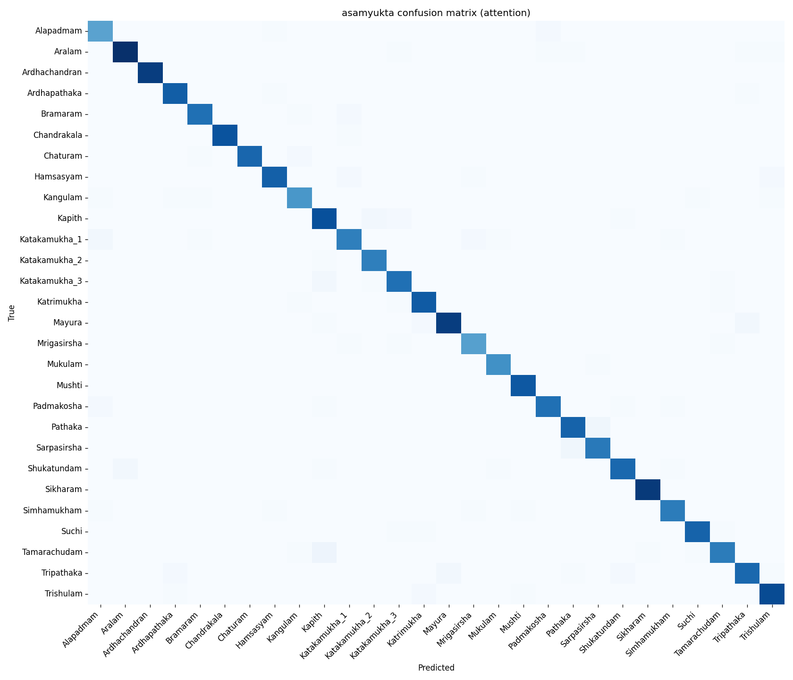
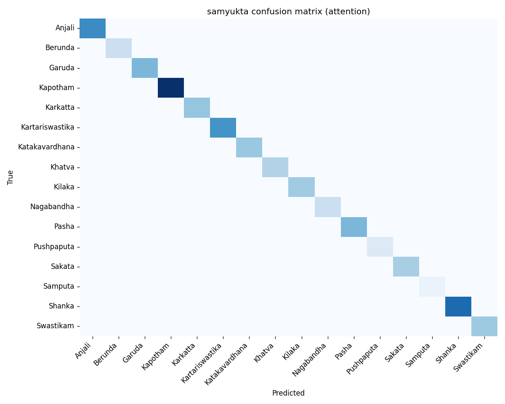

# Natya

Real-time Bharatanatyam mudra recognition, grounded in traditional viniyoga
(meaning) interpretation via retrieval-augmented generation over a
domain-expert-authored knowledge base.

<!-- TODO: record a short demo GIF (mudra -> live classification -> streamed
interpretation) and drop it here. -->

**Live demo:** _not yet deployed — see [DEPLOY.md](./DEPLOY.md)._

## Problem

A mudra (hand gesture) in Bharatanatyam is not just a shape — it's a symbol
with a *viniyoga*, a traditional meaning documented in texts like the
Abhinaya Darpana, and the same mudra can carry different meanings depending
on where it's held and how it moves. Pathaka above the head is a cloud;
Pathaka at the chest can be something else entirely. Recognizing the mudra
is a (comparatively) tractable classification problem. Recognizing *what it
means in context*, faithfully and without inventing meanings that aren't
canonical, is the harder and more interesting problem — and it's where a
generic hand-gesture classifier stops being useful to an actual dancer or
student.

This project does both: a real-time, in-browser mudra classifier, and an
LLM layer that interprets detected mudras grounded strictly in a
domain-expert-authored knowledge base, so it explains meaning instead of
just naming a class label.

## System architecture

```
Webcam
  │
  ▼
MediaPipe Hands + Pose (JS, on-device, WASM)
  │  21 keypoints/hand, 33 pose landmarks
  ▼
Landmark normalization (wrist-centered, scale-normalized)
  │
  ▼
ONNX classifier (in-browser, onnxruntime-web)
  │  1 hand  -> asamyukta model (28 classes, attention)
  │  2 hands -> samyukta model  (16 classes, MLP)
  ▼
Temporal smoothing (10-frame softmax average)
  │
  ▼
Stability gate (same top-1 label, >1s, >60% confidence)
  │
  ▼                                    Pose-derived context
  │                                    (arm raised / near chest /
  │                                    near face / extended forward)
  ▼                                              │
POST /interpret/stream  ◄───────────────────────┘
  │  (FastAPI + SSE)
  ▼
ChromaDB retrieval (top-6 viniyogas by embedding similarity,
  filtered to detected mudra)
  │
  ▼
Llama 3.3-class LLM (Groq), constrained to retrieved viniyogas only
  │
  ▼
Streamed natural-language interpretation → browser
```

Everything left of the `POST` runs entirely client-side — no server
round-trip for classification, which is what makes it feel real-time.

## Results

### Classifier accuracy

Two separate classifiers, split by hand count, because asamyukta
(single-hand) and samyukta (double-hand) mudras are geometrically distinct
problems — see [Design decisions](#design-decisions).

**Asamyukta (28 classes, attention model)** — top-1 **97.70%**, top-3
**99.32%**, macro F1 **0.977**, on a held-out validation split of 2,220
samples.

**Samyukta (16 classes, MLP)** — top-1 **99.54%**, top-3 **100.00%**, macro
F1 **0.996**, on a held-out validation split of 654 samples.

<details>
<summary>Per-class F1 (asamyukta)</summary>

| Class | Precision | Recall | F1 | Support |
|---|---|---|---|---|
| Aralam | 0.951 | 0.970 | 0.961 | 101 |
| Mayura | 0.979 | 0.969 | 0.974 | 98 |
| Sikharam | 0.989 | 1.000 | 0.995 | 92 |
| Ardhachandran | 1.000 | 1.000 | 1.000 | 91 |
| Trishulam | 0.936 | 0.967 | 0.951 | 91 |
| Kapith | 1.000 | 0.989 | 0.994 | 90 |
| Chandrakala | 1.000 | 1.000 | 1.000 | 86 |
| Hamsasyam | 0.976 | 0.988 | 0.982 | 84 |
| Katrimukha | 0.963 | 0.940 | 0.951 | 83 |
| Mushti | 1.000 | 1.000 | 1.000 | 82 |
| Shukatundam | 1.000 | 0.902 | 0.949 | 82 |
| Ardhapathaka | 0.940 | 0.963 | 0.951 | 81 |
| Pathaka | 0.929 | 0.963 | 0.945 | 81 |
| Suchi | 1.000 | 0.975 | 0.988 | 81 |
| Tripathaka | 0.987 | 0.938 | 0.962 | 81 |
| Padmakosha | 1.000 | 0.988 | 0.994 | 80 |
| Chaturam | 0.988 | 1.000 | 0.994 | 79 |
| Katakamukha_1 | 0.986 | 0.948 | 0.967 | 77 |
| Tamarachudam | 0.987 | 1.000 | 0.994 | 77 |
| Katakamukha_3 | 1.000 | 0.974 | 0.987 | 76 |
| Simhamukham | 0.937 | 0.974 | 0.955 | 76 |
| Bramaram | 0.973 | 0.986 | 0.980 | 74 |
| Sarpasirsha | 0.971 | 0.944 | 0.958 | 72 |
| Katakamukha_2 | 0.972 | 1.000 | 0.986 | 69 |
| Kangulam | 0.970 | 1.000 | 0.985 | 65 |
| Mukulam | 0.954 | 1.000 | 0.976 | 62 |
| Alapadmam | 1.000 | 1.000 | 1.000 | 56 |
| Mrigasirsha | 0.981 | 1.000 | 0.991 | 53 |

</details>

<details>
<summary>Per-class F1 (samyukta)</summary>

| Class | Precision | Recall | F1 | Support |
|---|---|---|---|---|
| Sakata | 1.000 | 1.000 | 1.000 | 96 |
| Kapotham | 1.000 | 1.000 | 1.000 | 85 |
| Kartariswastika | 1.000 | 1.000 | 1.000 | 62 |
| Pasha | 1.000 | 0.966 | 0.983 | 59 |
| Katakavardhana | 1.000 | 1.000 | 1.000 | 51 |
| Kilaka | 0.962 | 1.000 | 0.980 | 50 |
| Garuda | 1.000 | 1.000 | 1.000 | 49 |
| Swastikam | 1.000 | 0.973 | 0.986 | 37 |
| Khatva | 1.000 | 1.000 | 1.000 | 30 |
| Karkatta | 1.000 | 1.000 | 1.000 | 28 |
| Nagabandha | 0.960 | 1.000 | 0.980 | 24 |
| Shanka | 1.000 | 1.000 | 1.000 | 23 |
| Berunda | 1.000 | 1.000 | 1.000 | 22 |
| Anjali | 1.000 | 1.000 | 1.000 | 17 |
| Samputa | 1.000 | 1.000 | 1.000 | 11 |
| Pushpaputa | 1.000 | 1.000 | 1.000 | 10 |

</details>

| Asamyukta confusion matrix | Samyukta confusion matrix |
|---|---|
|  |  |

Full numbers: [`eval/classifier_metrics.json`](eval/classifier_metrics.json)
(regenerate with `python scripts/eval_all_classifiers.py`).

### LLM faithfulness: RAG vs. no-RAG

20 (mudra, context) test cases, run through the same model with and without
retrieval, scored against the canonical KB for grounding, hallucination, and
context-sensitivity. Methodology (lexical-overlap heuristic against the
model's named claims, not semantic entailment) and full transcripts are in
[`eval/llm_faithfulness.json`](eval/llm_faithfulness.json) — worth spot-
checking by hand, not just trusting the aggregate.

| Metric | With RAG | Without RAG |
|---|---|---|
| Grounded in a canonical viniyoga | **100%** | 35% |
| Hallucinated (claimed a non-canonical viniyoga) | **0%** | 5% |
| Context-sensitive (top-mentioned meaning matches the context given) | **100%** | 30% |

Regenerate with `python scripts/eval_llm.py` (requires `GROQ_API_KEY`).

### Latency

| Stage | P50 | P95 | Mean |
|---|---|---|---|
| Asamyukta classifier inference¹ | 0.17 ms | 0.56 ms | 0.23 ms |
| Samyukta classifier inference¹ | 0.01 ms | 0.01 ms | 0.01 ms |
| LLM time-to-first-token (HTTP, Groq) | 679 ms | 1567 ms | 787 ms |
| End-to-end² (classify → first token) | ~679 ms | ~1568 ms | ~787 ms |

¹ Measured via onnxruntime's native CPU execution provider as a proxy for
onnxruntime-web's WASM backend — WASM in-browser will be slower than this,
but classifier inference is not the bottleneck either way; the LLM call
dominates by 3+ orders of magnitude.
² Excludes the UI's deliberate 1000ms stability debounce (`STABLE_MS` in
`web/app.js`) — that's a UX choice to avoid firing on transient hand shapes,
not a pipeline cost. Regenerate with `python scripts/eval_latency.py`
(needs the server running locally).

## Design decisions

**Attention won on asamyukta, MLP won (tied) on samyukta.** Asamyukta
classification benefits from attention over the 21 keypoints because
distinguishing shapes like Katakamukha's sub-variants depends on relative
keypoint geometry the attention layer can learn explicitly. Samyukta has
half as many classes but a third as much usable training data (MediaPipe
only detects both hands in ~24% of double-hand samples — see
[Limitations](#real-world-limitations)), and low per-class sample counts
mean attention has nothing extra to learn that the MLP baseline doesn't
already capture from the 126-dim concatenated features. Shipping the
simpler model where it performs equally is the right call, not just the
convenient one.

**RAG over a fine-tuned or trained viniyoga model.** Viniyoga interpretation
isn't a classification problem with a fixed label space — it's contextual
selection over an authored knowledge base that can grow, and it needs to be
auditable (which canonical entry did the model pick, and why) rather than
baked into opaque weights. Retrieval also means updating the KB (adding a
mudra, correcting a translation) doesn't require retraining anything.

**ONNX + INT8 + in-browser inference.** No inference server for
classification means no per-request cost, no latency floor from a network
round trip, and no privacy concern about streaming someone's webcam feed to
a server. INT8 dynamic quantization cuts both models to ~200KB
(asamyukta: 456KB → 193KB; samyukta: 793KB → 204KB) with negligible accuracy
loss, since landmark coordinates are a well-behaved input distribution for
weight-only quantization.

**Llama (70B-class) via Groq.** Free-tier, fast (Groq's LPU inference is
materially faster time-to-first-token than most hosted alternatives at this
model size), and OpenAI-compatible, so swapping providers later is a
one-line change to `LLM_MODEL` in `src/llm/interpreter.py`. (Originally
built against `llama-3.3-70b-versatile`; Groq retired that model from the
free tier mid-project, so the shipped version uses `openai/gpt-oss-120b` —
a real example of a dependency on a third-party model catalog changing
under a live project, handled by isolating the model name to one constant.)

**Temporal smoothing on classifier outputs.** Raw per-frame predictions are
noisy — a hand mid-transition between two mudras produces flickering
top-1 labels frame to frame. Averaging softmax distributions over a
10-frame window (~333ms at 30fps) smooths the *decision* without adding
visible display lag, and resets on hand-count change or hand loss so it
doesn't carry stale state across a different gesture space.

**The knowledge base is authored, not scraped.** Viniyoga interpretation is
specific enough, and wrong often enough in generic web sources, that an LLM
answering from parametric knowledge alone hallucinates or picks
plausible-sounding but non-canonical meanings (see the no-RAG hallucination
numbers above). The KB entries were AI-drafted from the Abhinaya Darpana and
then verified against 14+ years of Bharatanatyam training — the same
standard I'd want an authoritative source to meet regardless of whether an
LLM helped write it.

## Real-world limitations

The validation metrics above are near-perfect because the validation split
comes from the *same dataset distribution* as training (same collection
conditions, similar subjects). They do not reflect what happens under
distribution shift on a novel webcam, and that gap is worth stating plainly
rather than hiding behind a 97-99% headline number:

- **Tripathaka's ring-finger bend**: the dataset's Tripathaka samples use a
  full ring-finger bend rather than the canonical half-bend. The model
  learned the dataset's convention, not the canonical form — a labeling
  convention limitation, not a model failure.
- **Chandrakala ↔ Suchi, Katakamukha_1/2/3, Bramaram → Katakamukha**: these
  are qualitative failure modes observed in live webcam use at certain hand
  orientations. Notably, **none of these pairs show any confusion in the
  held-out validation confusion matrix** (checked directly — zero
  misclassifications between each pair). That gap is the point: the failure
  mode is a distribution-shift problem (different lighting, hand size, skin
  tone, camera angle than the training distribution), not something the
  offline eval numbers would ever surface. A demo that only reports the
  validation metrics would be quietly overclaiming.
- **MediaPipe's two-hand detection rate**: only ~24% of the dataset's
  double-hand samples have both hands detected by MediaPipe at all — hand
  occlusion when hands are close together is precisely when samyuktas
  happen. The samyukta model is trained and evaluated on the ~3,269 usable
  samples that survive that filter; the other 76% of double-hand images
  were simply undetectable at the landmark-extraction stage, upstream of
  anything the classifier could fix.

## Setup and reproduction

```bash
# 1. Environment (Python 3.11 required — mediapipe has no 3.13 wheel)
conda create -n natya python=3.11 -y
conda activate natya
pip install -r requirements.txt

# 2. Secrets
cp .env.example .env
# edit .env and set GROQ_API_KEY (https://console.groq.com/keys)

# 3. Dataset + landmark extraction (downloads Samarth0710/bharatanatyam-mudra-dataset,
#    ~28k images; caches extracted landmarks to data/landmarks.npz)
python scripts/extract_landmarks.py

# 4. Train both classifiers (checkpoints saved to checkpoints/)
python scripts/train_asamyukta.py
python scripts/train_samyukta.py

# 5. Export to ONNX + quantize (writes web/models/*.onnx, classes.json)
python -m src.deploy.export_onnx
python -m src.deploy.quantize

# 6. Build the viniyoga vector index (writes data/kb/chroma/)
python -m src.kb.retrieval

# 7. Run the eval suite
python scripts/eval_all_classifiers.py
python scripts/eval_llm.py
python scripts/eval_latency.py   # needs the server running (step 9) in another terminal

# 8. Serve the frontend
cd web && python -m http.server 8000

# 9. Run the interpretation backend (separate terminal)
uvicorn src.llm.server:app --port 8001
```

Then open `http://localhost:8000`, grant camera access, and show a mudra.

Deploying to Render + Vercel: see [DEPLOY.md](./DEPLOY.md).

## Tech stack

- **Vision**: MediaPipe Hands + Pose (Python for dataset landmark
  extraction, JS/WASM for live browser inference)
- **Classifiers**: PyTorch (MLP + Transformer-encoder attention), exported
  to ONNX (opset 17), INT8 dynamic-quantized, served via onnxruntime-web
- **Retrieval**: ChromaDB (persistent, cosine similarity) +
  sentence-transformers `all-MiniLM-L6-v2`
- **LLM**: Groq-hosted Llama-class model, OpenAI-compatible streaming API
- **Backend**: FastAPI + sse-starlette (SSE streaming), uvicorn
- **Frontend**: vanilla JS (ES modules), no framework
- **Deploy**: Render (API), Vercel (static frontend)

## Attribution

- Dataset: [Samarth0710/bharatanatyam-mudra-dataset](https://huggingface.co/datasets/Samarth0710/bharatanatyam-mudra-dataset)
  on Hugging Face.
- Viniyoga knowledge base: drafted with AI assistance from the *Abhinaya
  Darpana* of Nandikeshvara, verified by the author against 14+ years of
  Bharatanatyam training.
