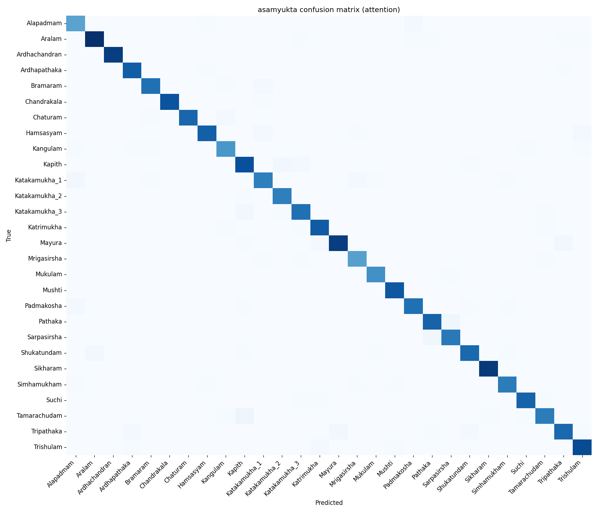
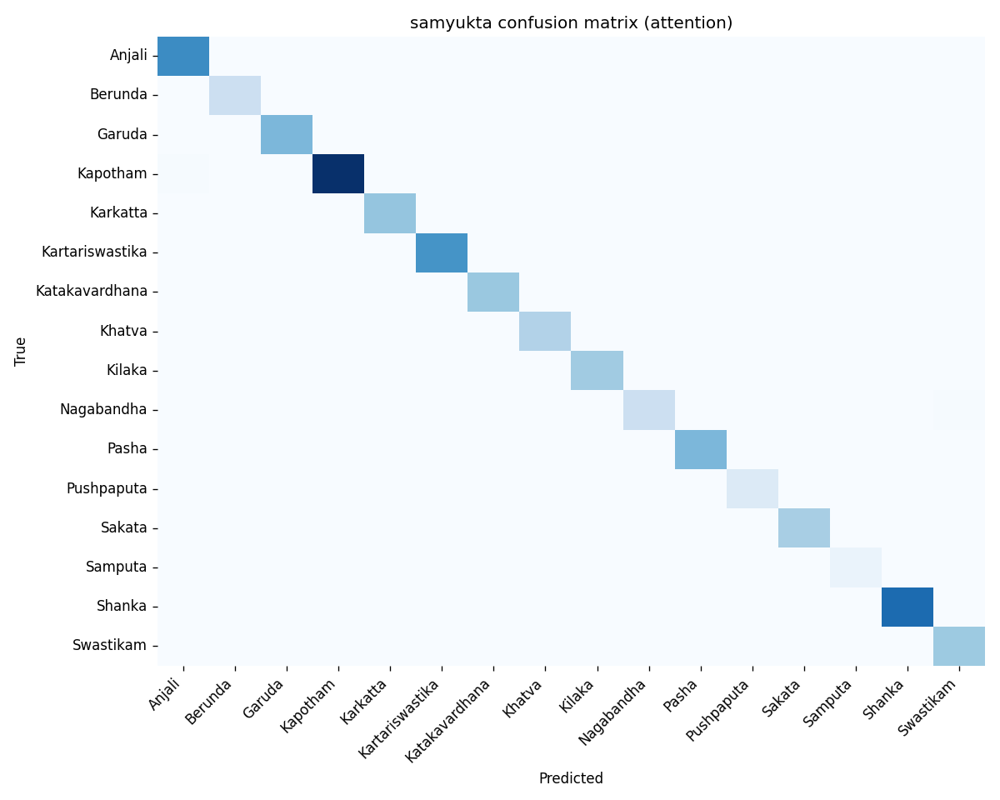

# Natya AI

Real-time Bharatanatyam mudra recognition in the browser, with an LLM that explains each mudra's traditional meaning (viniyoga) using only entries from an expert-verified knowledge base.

**Live demo:** [natya-ai-fawn.vercel.app](https://natya-ai-fawn.vercel.app). The API runs on Render's free tier, so the first explanation after a quiet period can take 30–60 seconds while the server wakes up.

## Why this project

In Bharatanatyam, a mudra (hand gesture) is a symbol, not just a shape. Each one has viniyogas, traditional meanings documented in texts like the *Abhinaya Darpana*, and the same mudra can mean different things depending on where it is held. Pataka raised above the head can represent a cloud, while at the chest it means something else.

Naming the mudra is a classification problem. Explaining what it means in context, without inventing meanings that are not canonical, is the harder part, and it is where a generic gesture classifier stops being useful to a dancer or student. Natya AI does both: it classifies mudras in real time on the user's device, then streams an explanation grounded in a knowledge base I verified against 14+ years of Bharatanatyam training.

## Results

| | Result |
|---|---|
| One-hand (asamyukta) mudras, 28 classes | 94.52% top-1, 98.32% top-3, macro-F1 0.944 (2,208 held-out samples) |
| Two-hand (samyukta) mudras, 16 classes | 99.69% top-1, 100% top-3, macro-F1 0.997 (651 held-out samples) |
| Accuracy on randomly rotated hands | 21% → 94% after rotation augmentation |
| LLM answers grounded in a canonical viniyoga | 95% with RAG vs. 45% without |
| LLM answers with a non-canonical meaning | 0% with RAG vs. 10% without |
| Classifier inference (one-hand model) | 0.17 ms median |

Validation data comes from the same studio-style dataset as training, so these numbers do not measure live webcam accuracy. See [Limitations](#limitations).

## How it works

```
Webcam
  │
  ▼
MediaPipe Hands + Pose (JS, on-device, WASM)
  │  21 keypoints per hand, 33 pose landmarks
  ▼
Landmark normalization (wrist-centered, scale-normalized)
  │
  ▼
ONNX classifier (in-browser, onnxruntime-web)
  │  1 hand  -> asamyukta model (28 classes, attention)
  │  2 hands -> samyukta model  (16 classes, attention)
  ▼
Temporal smoothing (10-frame softmax average)
  │
  ▼
Stability gate (same top-1 label, >1s, >60% confidence)
  │
  ▼                                    Pose-derived context
  │                                    (arm raised / near chest /
  │                                    near face / extended forward)
  ▼                                              │
POST /interpret/stream  ◄───────────────────────┘
  │  (FastAPI + SSE)
  ▼
ChromaDB retrieval (top-6 viniyogas by embedding similarity,
  filtered to the detected mudra)
  │
  ▼
LLM (openai/gpt-oss-120b via Groq), restricted to the retrieved viniyogas
  │
  ▼
Streamed explanation → browser
```

Everything before the `POST` runs on the user's device, so classification needs no server round trip.

## What went wrong and how I fixed it

### Validation looked great, but live predictions failed

Live webcam testing kept confusing mudras that are easy to tell apart, such as Tripataka and Mayura, while validation accuracy stayed above 97%. The cause was a mismatch between training and serving. I had extracted the dataset's landmarks with MediaPipe's legacy Python API, but the browser uses the newer Tasks API, which runs a different landmark model.

To confirm it, I ran the same classifier on 222 dataset images using landmarks from each API. Legacy landmarks, the kind the model trained on, scored 100%. Tasks landmarks, the kind the browser actually sends, scored 88.3%, and every error went in that direction.

I switched the extraction script to the Tasks API, using the same model files the browser loads, re-extracted landmarks for all 28,431 images, and retrained both classifiers.

My first check of the retrained model also scored 100%, which was suspicious. It turned out 81% of those 222 images were in the training set, so the test mostly measured memorization. Redoing the check on 909 held-out images from the same problem classes gave 96.4%, with real remaining confusion around Katakamukha_1 and Tripataka.

Validation accuracy dropped after this fix (97.70% → 96.20%). That drop is expected: the old number came from the same kind of landmarks the model trained on, which is exactly what hid the bug. The new number reflects what the browser sends.

### The model learned hand orientation as a shortcut

After that fix, two mudras still failed live. Chandrakala read as Suchi, and Bramaram as Katakamukha_1, despite 97–99% validation recall. The dataset photographs hands almost entirely side-on at a fixed tilt per class (Chandrakala's wrist-to-middle-knuckle axis sits 48–79° from vertical in 80% of samples), and my normalization removed position and scale but not rotation. The classifier had learned tilt as a feature.

Rotating validation hands upright reproduced the problem offline: 0% on upright Chandrakala and 21% overall under random rotation. Adding random in-plane rotation during training (`random_rotate` in `src/data/preprocess.py`) raised those to 98% and 94%, at a cost of about 1.7 points of standard validation accuracy (96.20% → 94.52%).

I also tried ±35° out-of-plane tilt to simulate palm-facing views. That broke Pataka live, which started reading as Sarpasirsha, because the two differ mainly by a slight cup and backward angle that the tilt created artificially. Removing the tilt brought held-out Pataka→Sarpasirsha errors from 5% back to 1%. Pataka still occasionally reads as Sarpasirsha live, so this one is not fully solved.

### Flickering labels kept explanations from finishing

Per-frame predictions flicker as a hand moves between shapes. Averaging softmax over 10 frames smoothed the decision but not the displayed label, and the pose context sent to the LLM ("near chest" vs. "near face") also flickered on a still hand. Each flicker changed the request, so the app kept canceling and restarting the LLM call before any text appeared. I fixed this with an EMA filter on raw landmark positions and hysteresis on both the displayed label and the context string. The landmark filter, softmax average, and label hysteresis all reset when the hand leaves the frame.

### The LLM provider retired my model mid-project

I built the interpreter against Groq's `llama-3.3-70b-versatile`, which Groq removed from its free tier during the project. Because the model name lives in one constant in `src/llm/interpreter.py`, switching to `openai/gpt-oss-120b` was a one-line change.

## Design decisions

**Two classifiers, split by hand count.** One-hand and two-hand mudras are geometrically different problems. Attention over the 21 keypoints helps the one-hand model separate shapes that differ only in relative finger geometry, like the Katakamukha variants. On two-hand mudras, attention and an MLP baseline originally tied. After retraining on the corrected landmarks, attention leads by about 1 point (99.69% vs. 98.77%), which suggests landmark noise, not just the small sample size, caused the original tie.

**RAG instead of fine-tuning.** Viniyoga interpretation is selection from a curated set of meanings that grows over time, not a fixed label space. Retrieval makes every answer traceable to a specific knowledge base entry, and adding or correcting a meaning requires no retraining.

**In-browser ONNX inference.** Classifying on the user's device means no per-request cost, no network delay, and no webcam video sent to a server. INT8 dynamic quantization shrinks both models (one-hand: 456 KB → 193 KB; two-hand: 1,404 KB → 473 KB) with negligible accuracy loss.

**An authored knowledge base.** Generic web sources are often wrong about viniyogas, and the no-RAG results show the LLM inventing meanings when it relies on its own knowledge. The entries were drafted with AI assistance from the *Abhinaya Darpana* and then verified against my 14+ years of Bharatanatyam training.

## Detailed results

### Classifier accuracy

The tables use the classifier's raw labels, which follow the dataset's spellings ("Pathaka", "Tripathaka"). The app maps these to standard Sanskrit transliteration ("Pataka", "Tripataka") for display and knowledge base lookups through [`web/models/mudra_display_names.json`](web/models/mudra_display_names.json).

<details>
<summary>Per-class F1 (asamyukta)</summary>

| Class | Precision | Recall | F1 | Support |
|---|---|---|---|---|
| Aralam | 0.960 | 0.950 | 0.955 | 101 |
| Mayura | 0.959 | 0.959 | 0.959 | 97 |
| Sikharam | 0.989 | 1.000 | 0.995 | 92 |
| Ardhachandran | 0.989 | 1.000 | 0.995 | 91 |
| Kapith | 0.920 | 0.900 | 0.910 | 90 |
| Trishulam | 0.955 | 0.933 | 0.944 | 90 |
| Chandrakala | 0.988 | 0.976 | 0.982 | 84 |
| Tripathaka | 0.962 | 0.893 | 0.926 | 84 |
| Hamsasyam | 0.975 | 0.940 | 0.957 | 83 |
| Katrimukha | 0.890 | 0.880 | 0.885 | 83 |
| Ardhapathaka | 0.941 | 0.988 | 0.964 | 81 |
| Mushti | 0.975 | 0.963 | 0.969 | 81 |
| Pathaka | 0.915 | 0.926 | 0.920 | 81 |
| Shukatundam | 0.915 | 0.926 | 0.920 | 81 |
| Suchi | 0.917 | 0.963 | 0.939 | 80 |
| Chaturam | 0.974 | 0.962 | 0.968 | 79 |
| Katakamukha_3 | 0.935 | 0.935 | 0.935 | 77 |
| Padmakosha | 0.986 | 0.935 | 0.960 | 77 |
| Tamarachudam | 0.920 | 0.908 | 0.914 | 76 |
| Bramaram | 0.947 | 0.960 | 0.954 | 75 |
| Katakamukha_1 | 0.957 | 0.880 | 0.917 | 75 |
| Sarpasirsha | 0.971 | 0.932 | 0.951 | 73 |
| Simhamukham | 0.893 | 0.931 | 0.912 | 72 |
| Katakamukha_2 | 0.907 | 1.000 | 0.951 | 68 |
| Kangulam | 0.921 | 0.921 | 0.921 | 63 |
| Mukulam | 0.938 | 0.984 | 0.960 | 61 |
| Mrigasirsha | 0.917 | 0.965 | 0.940 | 57 |
| Alapadmam | 0.915 | 0.964 | 0.939 | 56 |

</details>

<details>
<summary>Per-class F1 (samyukta)</summary>

| Class | Precision | Recall | F1 | Support |
|---|---|---|---|---|
| Kapotham | 1.000 | 0.990 | 0.995 | 97 |
| Shanka | 1.000 | 1.000 | 1.000 | 74 |
| Anjali | 0.984 | 1.000 | 0.992 | 62 |
| Kartariswastika | 1.000 | 1.000 | 1.000 | 59 |
| Garuda | 1.000 | 1.000 | 1.000 | 44 |
| Pasha | 1.000 | 1.000 | 1.000 | 44 |
| Karkatta | 1.000 | 1.000 | 1.000 | 38 |
| Katakavardhana | 1.000 | 1.000 | 1.000 | 37 |
| Swastikam | 0.973 | 1.000 | 0.986 | 36 |
| Kilaka | 1.000 | 1.000 | 1.000 | 35 |
| Sakata | 1.000 | 1.000 | 1.000 | 33 |
| Khatva | 1.000 | 1.000 | 1.000 | 30 |
| Nagabandha | 1.000 | 0.955 | 0.977 | 22 |
| Berunda | 1.000 | 1.000 | 1.000 | 21 |
| Pushpaputa | 1.000 | 1.000 | 1.000 | 13 |
| Samputa | 1.000 | 1.000 | 1.000 | 6 |

</details>

| Asamyukta confusion matrix | Samyukta confusion matrix |
|---|---|
|  |  |

Full numbers are in [`eval/classifier_metrics.json`](eval/classifier_metrics.json). Regenerate them with `python scripts/eval_all_classifiers.py`.

### LLM faithfulness: RAG vs. no RAG

I ran 20 (mudra, context) test cases through the same model with and without retrieval and scored each answer against the canonical knowledge base.

| Metric | With RAG | Without RAG |
|---|---|---|
| Grounded in a canonical viniyoga | **95%** | 45% |
| Claimed a non-canonical viniyoga | **0%** | 10% |
| Top meaning matches the given context | **100%** | 20% |

Grounded is 95% rather than 100% because one RAG case returned an empty response from a temporary Groq API error. Scoring uses a lexical-overlap heuristic, not semantic entailment, so the full transcripts in [`eval/llm_faithfulness.json`](eval/llm_faithfulness.json) are worth spot-checking by hand. Regenerate with `python scripts/eval_llm.py` (requires `GROQ_API_KEY`).

### Latency

| Stage | P50 | P95 | Mean |
|---|---|---|---|
| Asamyukta classifier inference¹ | 0.17 ms | 0.56 ms | 0.23 ms |
| Samyukta classifier inference¹ | 0.01 ms | 0.01 ms | 0.01 ms |
| LLM time to first token (HTTP, Groq) | 679 ms | 1567 ms | 787 ms |
| End to end² (classify → first token) | ~679 ms | ~1568 ms | ~787 ms |

¹ Measured with onnxruntime's native CPU backend as a stand-in for the browser's WASM backend, which is slower. Either way, the LLM call dominates by more than three orders of magnitude.
² Excludes the 1-second stability delay (`STABLE_MS` in `web/app.js`), which is a deliberate UX choice to avoid reacting to passing hand shapes. Regenerate with `python scripts/eval_latency.py` while the server is running.

## Limitations

- **Static poses only.** The classifier sees one hand shape per frame. It cannot recognize two different mudras held on two hands at once (the two-hand model knows only 16 specific combined shapes), gestures traced through space, or mudras defined by motion, such as Sandamsha. Supporting those would need a sequence model and training data that does not exist yet.
- **Partial bends are not recognized until fully formed.** The dataset contains only finished poses, so mudras that differ by degree of finger bend (Pataka → Tripataka, Pataka ↔ Ardhapataka) switch labels only when the hand matches the dataset's version of the target. The dataset's Tripataka uses a full ring-finger bend rather than the canonical half bend, so the model learned the dataset's convention.
- **Closed set.** A mudra outside the 28 + 16 trained classes, such as Hamsapaksha, will always be reported as its nearest known class, since the model has no "none of the above" option.
- **Two-hand detection.** MediaPipe detects both hands in only about 24% of the dataset's two-hand images, because hands overlap exactly when samyukta mudras happen. The two-hand model trains and evaluates on the roughly 3,254 samples that survive that filter.
- **Live accuracy differs from validation.** Validation images come from the same studio-style collection as training. Live testing so far has been one person on one camera setup, and webcam lighting, background, and hand presentation still cause errors the fixes above do not address. Several confusions seen in early live testing predate the landmark fix and haven't been retested since.

## Setup and reproduction

```bash
# 1. Environment (Python 3.11 required; mediapipe has no 3.13 wheel)
conda create -n natya python=3.11 -y
conda activate natya
pip install -r requirements.txt

# 2. Secrets
cp .env.example .env
# edit .env and set GROQ_API_KEY (https://console.groq.com/keys)

# 3. Dataset + landmark extraction (downloads Samarth0710/bharatanatyam-mudra-dataset,
#    about 28k images; caches extracted landmarks to data/landmarks.npz)
python scripts/extract_landmarks.py

# 4. Train both classifiers (checkpoints saved to checkpoints/)
python scripts/train_asamyukta.py
python scripts/train_samyukta.py

# 5. Export to ONNX + quantize (writes web/models/*.onnx, classes.json)
python -m src.deploy.export_onnx
python -m src.deploy.quantize

# 6. Build the viniyoga vector index (writes data/kb/chroma/)
python -m src.kb.retrieval

# 7. Run the eval suite
python scripts/eval_all_classifiers.py
python scripts/eval_llm.py
python scripts/eval_latency.py   # needs the server running (step 9) in another terminal

# 8. Serve the frontend
cd web && python -m http.server 8000

# 9. Run the interpretation backend (separate terminal)
uvicorn src.llm.server:app --port 8001

# 10. Run the tests (the LLM and MediaPipe are stubbed or not needed)
pip install -r requirements-dev.txt
pytest
```

Then open `http://localhost:8000`, allow camera access, and show a mudra. For deploying to Render and Vercel, see [DEPLOY.md](./DEPLOY.md).

**`protobuf`/`mediapipe` import error:** if `import mediapipe` raises `AttributeError: 'MessageFactory' object has no attribute 'GetPrototype'`, the environment has picked up `protobuf>=5`. Mediapipe needs `protobuf<5,>=4.25.3`, while chromadb's `opentelemetry-proto` dependency wants `>=5`. Run `pip install "protobuf==4.25.3"`. Pip will warn about `opentelemetry-proto`, which is harmless for the training scripts because they never import chromadb.

## Tech stack

- **Vision:** MediaPipe Hands + Pose (Python for dataset landmark extraction, JS/WASM for live browser inference)
- **Classifiers:** PyTorch (MLP + Transformer-encoder attention), exported to ONNX (opset 17), INT8 dynamic quantization, served with onnxruntime-web
- **Retrieval:** ChromaDB (persistent, cosine similarity) + `all-MiniLM-L6-v2` embeddings through ONNX Runtime, without torch, so the API fits Render's 512 MB free tier
- **LLM:** `openai/gpt-oss-120b` on Groq, OpenAI-compatible streaming API
- **Backend:** FastAPI + sse-starlette (SSE streaming), uvicorn
- **Frontend:** vanilla JS (ES modules), no framework
- **Deploy:** Render (API), Vercel (static frontend)

## Attribution

- Dataset: [Samarth0710/bharatanatyam-mudra-dataset](https://huggingface.co/datasets/Samarth0710/bharatanatyam-mudra-dataset) on Hugging Face.
- Viniyoga knowledge base: drafted with AI assistance from the *Abhinaya Darpana* of Nandikeshvara, then verified by the author against 14+ years of Bharatanatyam training.
